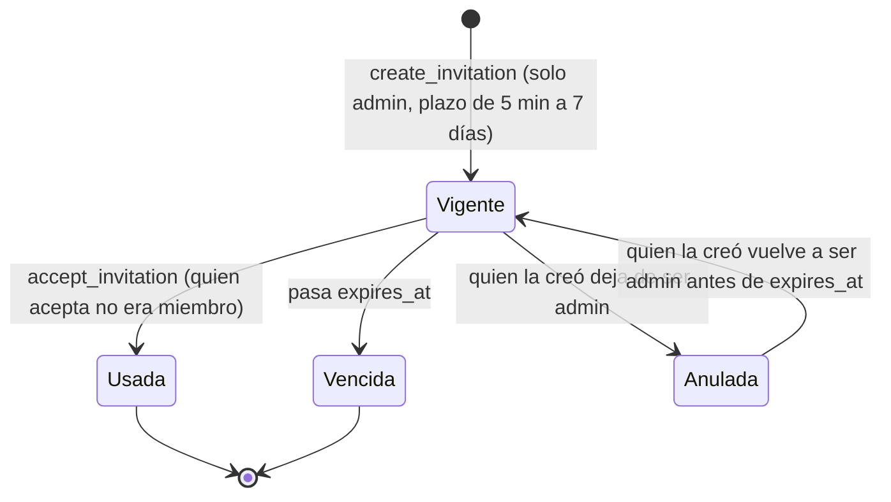
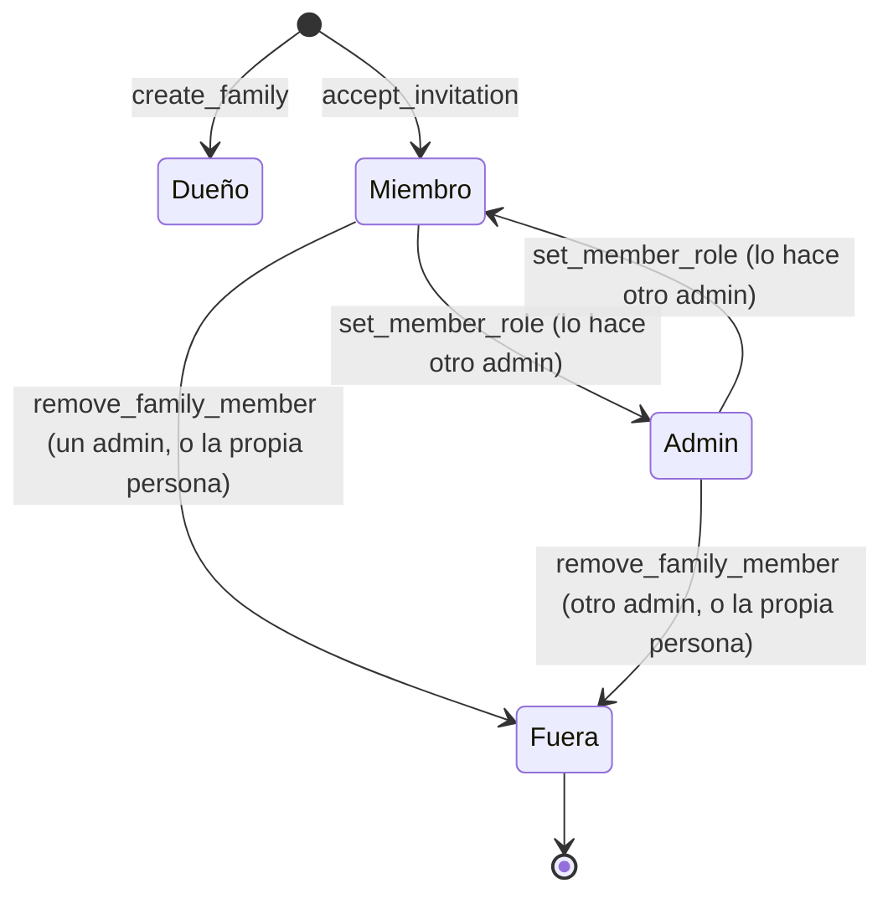
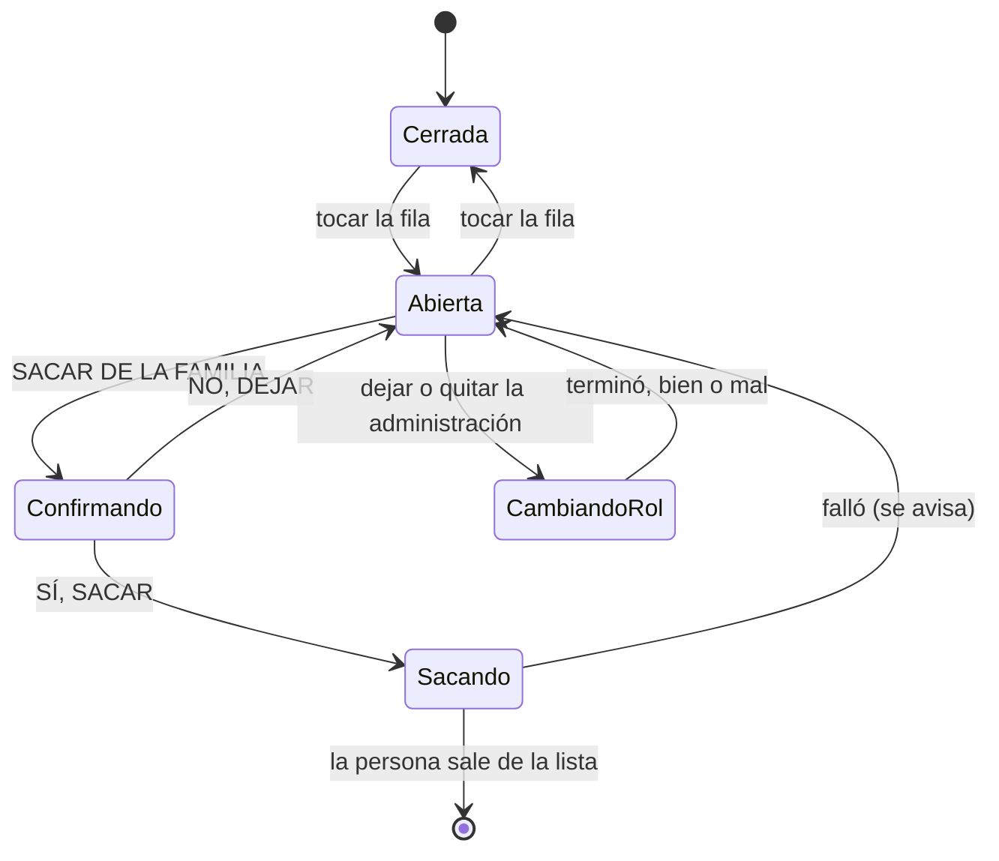

# Estados y transiciones

Las reglas de este documento están implementadas en `supabase/migrations/20261119000000_reglas_de_familia.sql` y verificadas por `tests/db/rules.test.ts`. Cada invariante indica qué la protege.

## Invitación

Usada y Vencida son finales. Una invitación solo se puede aceptar en el estado Vigente.

| Invariante | Qué la protege |
|---|---|
| Un token se usa una sola vez | `accept_invitation` consume con un único `UPDATE ... WHERE used_at IS NULL`. Dos aceptaciones simultáneas compiten por el bloqueo de la fila y la segunda ve `used_at` ya escrito. |
| Una invitación vencida no sirve | Condición `expires_at > now()` en el mismo `UPDATE`. |
| El token en claro no se guarda | Constraint `family_invitations_token_hash_format`. |
| Un intento fallido no gasta la invitación | El `UPDATE` y el alta del miembro ocurren en la misma función: si el alta falla, el consumo se deshace. |
| Un admin expulsado o degradado no deja puertas abiertas | El `UPDATE` exige que `created_by` siga siendo admin de la familia. |

## Membresía

El Dueño no tiene transiciones de salida: no se le puede cambiar el rol ni sacar, y no puede irse. La única forma de que deje de serlo es borrar la familia.

| Invariante | Qué la protege |
|---|---|
| Toda familia tiene al menos un administrador | Constraint triggers diferidos `families_owner_is_admin` y `family_members_owner_is_admin`: el dueño siempre es miembro con rol admin, aunque alguien escriba las tablas directo. |
| Nadie cambia su propio rol | `set_member_role` rechaza `p_target = p_actor`. |
| Un miembro regular no saca ni asciende a nadie | `require_admin` en `remove_family_member` y `set_member_role`. |
| Salir de la familia invalida el código de hoy | `remove_family_member` incrementa `code_epoch` en la misma transacción. |
| Quien sale pierde el acceso al instante | Toda función consulta `family_members` en cada llamada; no hay caché de membresía. |
| No se puede averiguar qué familias existen | Familia ajena y familia inexistente responden el mismo `not_a_member`. |
| El cliente no puede saltarse las reglas | `anon` y `authenticated` no tienen uso del esquema `app`, ni execute, ni privilegios sobre las tablas. |

## Sacar a alguien desde la aplicación

Estados de la fila de un miembro en la pantalla Mi familia, para quien administra. Salir de la familia sigue el mismo camino con una sola persona: la propia.

| Invariante | Qué la protege |
|---|---|
| Nadie sale de una familia con un solo toque | `remove-family-member` solo se llama desde Confirmando. Tests "sacar a alguien pide confirmación" y "salir pide confirmación" en `src/App.test.tsx`. |
| Un toque doble no repite la acción | En Sacando y CambiandoRol los botones están deshabilitados. Test "mientras se saca a alguien no se puede apretar dos veces". |
| Lo que muestra la pantalla no decide nada | Las filas que se pueden abrir son solo una ayuda: quién puede sacar o ascender lo deciden `remove_family_member` y `set_member_role` en cada llamada. |
| Quien sale no sigue viendo el código | Al salir se descarta la lista de familias antes de volver a pedirla. Test "al salir deja de pedirse el código de esa familia". |

