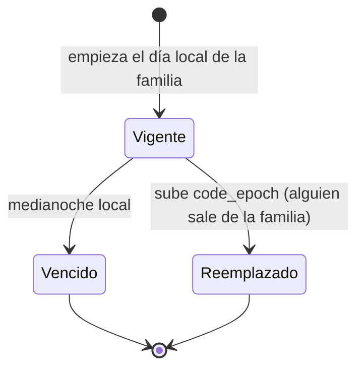

# Motor del código diario

Implementación: `supabase/functions/_shared/daily-code.ts` y `local-day.ts`. El código nunca se guarda: se deriva cada vez que un miembro lo pide.

## Algoritmo (versión 1)

```
mensaje  = "santo-y-sena/daily-code\nv=1\nfamily=<uuid>\ndate=<YYYY-MM-DD>\nepoch=<n>\nwords=<2|3>"
bloque_i = HMAC-SHA256(SERVER_SECRET, mensaje + "\nblock=" + i)        i = 0, 1, 2, ...
```

Los bloques forman un flujo de bits. Se leen de a `ceil(log2(N))` bits, del más significativo al menos, sin partir un valor entre dos bloques. Un valor menor que `N` (tamaño de la lista) es un índice; uno mayor o igual se descarta. Con la lista de 4.096 palabras se leen 12 bits y nunca se descarta nada; el descarte existe para que una lista futura de otro tamaño tampoco tenga sesgo.

- `family` es el UUID de la familia, `date` su fecha local, `epoch` su `code_epoch`.
- Todos los campos tienen forma fija, así que dos entradas distintas no pueden producir el mismo mensaje.
- `words` entra al mensaje: pasar a tres palabras cambia el código entero, no le agrega una palabra al anterior.
- La llave se importa como llave HMAC no extraíble con Web Crypto.

## Fecha y vencimiento

La fecha la calcula el servidor con su reloj y la zona horaria de la familia. La petición solo lleva `family_id`: no existe ningún campo con el que el cliente pueda elegir la fecha.

El código vence en el primer instante en que la fecha local cambia. Ese instante se busca, no se calcula sumando 24 horas, porque en Chile:

- el día en que empieza el horario de verano dura 23 horas y parte a la 01:00 (las 00:00 no existen);
- el día en que termina dura 25 horas.

## Estados de un código



Invariante: en cada instante una familia tiene exactamente un código vigente, que es función de su fecha local y su `code_epoch`. Un código vencido o reemplazado no se puede volver a obtener por la API, porque `get-family-code` no acepta fecha ni época. La protegen los tests de `tests/functions/handle.test.ts` (sección get-family-code) y `tests/functions/daily-code.test.ts`.

## Límites

Dos palabras de 4.096 dan 24 bits. Sirve para que nadie adivine el código en una llamada; no es autenticación fuerte. No existe ningún servicio que diga si un código es correcto, así que no se puede probar a ciegas contra la API.

Quien obtenga `SERVER_SECRET` puede calcular los códigos de cualquier familia y fecha si conoce su UUID y su `code_epoch`.

## SERVER_SECRET

- 32 bytes aleatorios o más, en base64: `openssl rand -base64 32`.
- Vive solo como secreto de las Edge Functions. No va en el repositorio, en el cliente ni en logs.
- Si falta o es corto, `get-family-code` responde `internal_error` y no entrega palabras.

### Rotación

Cambiar la llave cambia el código de todas las familias en el momento del despliegue.

1. Elegir una hora de poco uso y avisar antes en la aplicación que el código cambiará.
2. Generar la llave nueva y guardarla como secreto de las Edge Functions (`supabase secrets set SERVER_SECRET=...`).
3. Volver a desplegar `get-family-code`.
4. Comprobar con una familia de prueba que el código cambió y que dos miembros ven el mismo.
5. Destruir la llave anterior.

Si la llave se filtró, la rotación es inmediata y no espera a una hora de poco uso.

## Pasar a tres palabras

`dailyCode` ya acepta `wordCount: 3` y está probado. Falta decidir cómo se activa por familia (una columna en `families`) y mostrar la tercera palabra en la interfaz.
