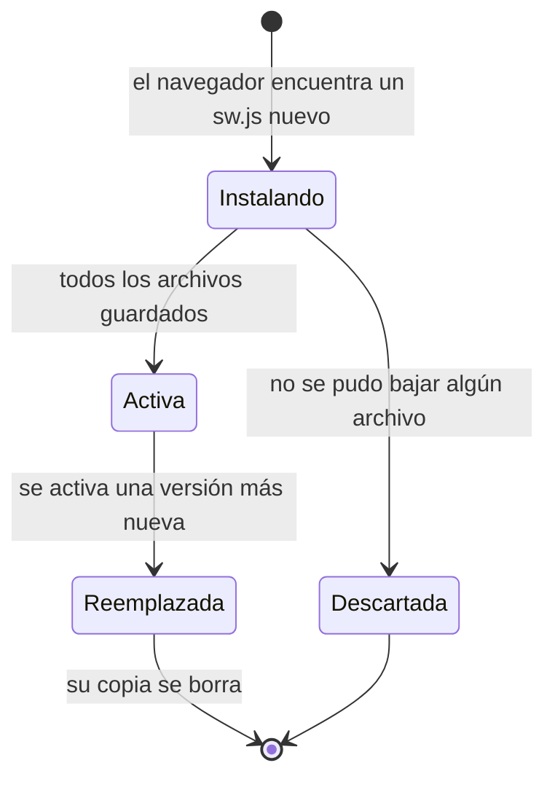

# Abrir la aplicación sin conexión

La aplicación se puede instalar en el teléfono y abre aunque no haya internet. El código del día no: lo calcula el servidor en cada consulta y el teléfono no lo guarda en ninguna parte. Sin conexión la pantalla dice que no pudo cargar, en vez de mostrar un código que quizá ya cambió.

## Qué guarda el teléfono

Un service worker (`src/pwa/sw.ts`) guarda los archivos de la aplicación: la página, su JavaScript, su CSS, el ícono y el manifiesto. La lista se arma al construir (`vite.config.ts`) y lleva una versión que cambia cuando cambia cualquiera de esos archivos.

Las peticiones al servidor no pasan por el service worker. Solo responde peticiones GET a direcciones que están en esa lista; todo lo demás sigue directo a la red.

## Versiones

Una versión nueva se activa apenas termina de instalarse, sin esperar a que se cierre la aplicación. La pantalla que ya estaba abierta sigue con lo que cargó; la próxima vez que se abre usa la versión nueva.

| Invariante | Qué la protege |
|---|---|
| El código del día nunca queda guardado | El service worker no escribe en su almacén fuera de la instalación, y ahí solo guarda la lista fija. Tests "nada que no esté en la lista" y "ninguna petición que no sea GET" en `src/pwa/shell-cache.test.ts`; `pnpm check:sw` ejecuta el service worker construido y falla si responde una petición al servidor; la prueba `e2e/sin-conexion.spec.ts` lista lo guardado en un navegador real. |
| Sin conexión la aplicación abre completa | `pnpm check:sw` compara lo que el service worker guarda con los archivos de `dist`, uno por uno. |
| Una versión a medio bajar no se usa | La instalación guarda todo o falla. Test "si un archivo no se puede bajar, la instalación falla". |
| No se mezclan archivos de dos versiones | Cada versión lee solo de su propia copia. Test "no entrega copias de una versión anterior". |
| No quedan versiones viejas ocupando espacio | Al activarse borra las anteriores y nada más. Test "borra las versiones anteriores y no toca lo que no es suyo". |

## Lo que no hace

No hay notificaciones, ni sincronización en segundo plano, ni aviso de "hay una versión nueva".
